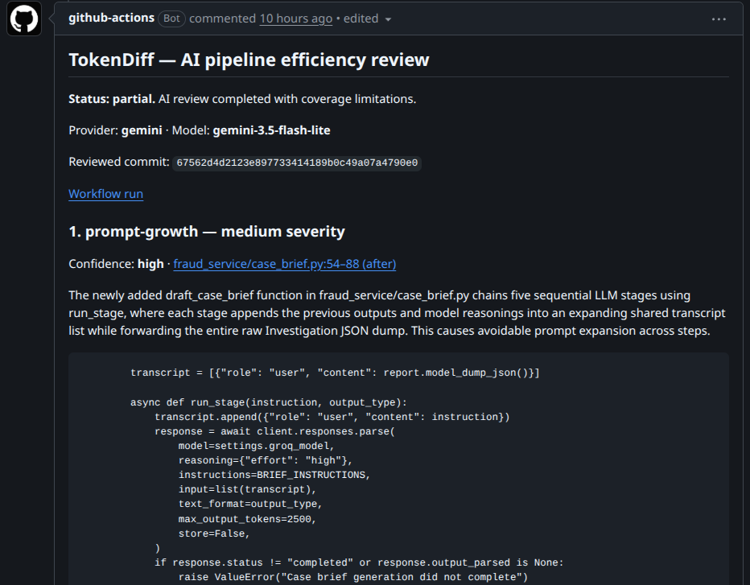
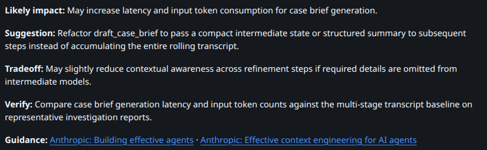

# TokenDiff

**Catch AI cost regressions before you merge: bloated prompts, duplicate tool calls, and unnecessary agent handoffs.**  
TokenDiff reviews your PR and suggests concrete pipeline changes using retrieved guidance from research such as **FrugalGPT, RouteLLM, and LLMLingua**.

A GitHub Action for any programming language. Bring your own Gemini or OpenAI key; get one updated PR comment with source evidence, suggestions, and research links. No TokenDiff account, backend, or instrumentation required. Findings are advisory and never block a merge.

[Get started](#quickstart-gemini-free-tier) · [See an example](#what-a-review-looks-like) · [How it works](#how-it-works) · [Configuration](#inputs-and-outputs)

## Quickstart: Gemini free tier

TokenDiff is free, open-source software. You can run reviews using Gemini's free API quota when your account and chosen model are eligible. Provider quotas and GitHub Actions usage limits still apply.

### 1. Add your API key and model

Get a [Gemini API key](https://ai.google.dev/gemini-api/docs/api-key). In your GitHub repository, open **Settings → Secrets and variables → Actions** and add:

| Type | Name | Value |
| --- | --- | --- |
| Repository secret | `GEMINI_API_KEY` | Your Gemini API key. |
| Repository variable | `TOKENDIFF_GEMINI_MODEL` | An explicit model ID available to your account with free-tier quota and support for [structured outputs through Interactions](https://ai.google.dev/gemini-api/docs/structured-output). |

Check the model's [free-tier availability and pricing](https://ai.google.dev/gemini-api/docs/pricing) before using it. TokenDiff does not select or switch models for you.

### 2. Add the workflow

Create `.github/workflows/tokendiff.yml` with the following content. Replace `YOUR_RELEASE_SHA` with the full commit SHA of the TokenDiff revision you reviewed; a pushed commit works before a release tag exists. You can also copy the [example workflow](examples/tokendiff.yml).

```yaml
name: TokenDiff
on:
  pull_request:
    types: [opened, synchronize, reopened, ready_for_review]

permissions:
  contents: read
  pull-requests: write

concurrency:
  group: tokendiff-${{ github.event.pull_request.number }}
  cancel-in-progress: true

jobs:
  review:
    runs-on: ubuntu-latest
    timeout-minutes: 10
    steps:
      - name: Review AI pipeline efficiency
        id: tokendiff
        uses: umer901/TokenDiff@YOUR_RELEASE_SHA
        with:
          provider: gemini
          model: ${{ vars.TOKENDIFF_GEMINI_MODEL }}
          api-key: ${{ secrets.GEMINI_API_KEY }}
```

No checkout step is needed: TokenDiff reads immutable source revisions through GitHub's API.

### 3. Open a pull request

Push the workflow to your default branch, then open a PR that changes an AI pipeline. For a useful first review, try a change that repeats the same retrieval call or appends the same large tool result twice to a prompt.

Open the PR to see TokenDiff's review comment, or go to **Actions → TokenDiff → Summary**. Subsequent runs update the same comment. A review with no supported findings is a valid result; unrelated changes and justified additional work should not produce findings.

Missing API keys skip the review. Exhausted quota produces an explicit error report and warning, never a clean review. Fork and Dependabot PRs normally lack access to repository secrets.

> **About “free”:** A Gemini key does not guarantee free calls. Availability, billing, quotas, and data handling depend on your model, account, and region. Review Google's [pricing](https://ai.google.dev/gemini-api/docs/pricing), [rate limits](https://ai.google.dev/gemini-api/docs/rate-limits), and [data-use terms](https://ai.google.dev/gemini-api/terms) before sending code. Unpaid services can use submitted content to improve Google's products; the terms include regional exceptions and restrictions.

## What a review looks like

### Changes worth reviewing

Efficiency regressions often arrive as reasonable feature changes. These illustrative diffs show the kinds of tradeoffs TokenDiff can review.

**Giving a formatting stage more context.** A PR forwards the analyst's full conversation to the stage that renders an approved decision:

```diff
 decision = await analyze_case(case, retrieved_documents)
 return await render_customer_summary(
     decision=decision.approved_summary,
-    context=decision.required_citations,
+    context=decision.full_transcript,
     instructions="Format the approved decision; do not re-evaluate it.",
 )
```

**Potential suggestion:** Keep the analysis and presentation stages separate, passing the approved facts and required citations through a compact, structured contract. The full transcript may add irrelevant tool output and intermediate reasoning. Validate that summaries retain required evidence before reducing context.

**Simplifying a pipeline by removing conditional work.** A PR makes a specialist review part of every request:

```diff
 assessment = await assess_claim(claim)
-if assessment.needs_specialist_review:
-    assessment = await specialist_review(claim, assessment)
+assessment = await specialist_review(claim, assessment)
 return await format_decision(assessment)
```

**Potential suggestion:** Retain conditional escalation if the existing gate reliably identifies cases needing specialist work. Evaluate whether a smaller model can handle the bounded formatting stage while preserving the specialist for difficult cases. Compare quality, escalation rate, and total usage; unconditional review may be justified by a new safety requirement.

These are possible review directions, not guaranteed findings. A smaller-model suggestion needs supporting context about the stage's requirements and current routing; the function name alone is insufficient.

### Evidence in the PR comment

In this separate pipeline example, TokenDiff flagged a growing transcript passed through five sequential model stages. The comment identifies the changed source and explains the suspected regression. The **partial** status makes the review's coverage limitations visible.



### A concrete next step

The review suggests passing compact intermediate state between stages, explains what context could be lost, and proposes a way to check quality and usage. Links connect the suggestion to the retrieved engineering guidance.



Each finding includes severity, confidence, a changed source location, exact evidence, likely impact, a concrete suggestion, its tradeoff, a verification plan, and links to retrieved optimization guidance.

Extra calls and longer prompts can serve new functionality or safety requirements. TokenDiff asks the model to account for those tradeoffs and report only plausible regressions. It does not invent runtime token totals or cost savings. These screenshots illustrate review output, not measured savings or guaranteed detection.

## How it works

1. **Read the PR.** Compare immutable merge-base and head revisions, prioritizing changed code within a bounded context budget.
2. **Retrieve relevant techniques.** Select guidance from a bundled research and engineering catalog using signals in the code.
3. **Review once.** Send the selected code and guidance to your chosen provider, looking for inefficiencies introduced or worsened by this PR.
4. **Validate and report.** Check findings against supplied source excerpts and retrieved references, then publish a PR comment, job summary, and JSON report.

TokenDiff reviews source code; it does not measure your application's runtime usage. Existing inefficiencies are outside the review's scope, and an empty result covers only the code included in the review.

## Research-backed suggestions

Before each review, TokenDiff retrieves relevant guidance from a bundled collection of nine techniques based on **FrugalGPT, RouteLLM, LLMLingua, LongLLMLingua**, and primary engineering guidance from Anthropic and OpenAI. This local lexical RAG step requires no backend, vector database, embeddings key, or live web access.

Suggestions can identify smaller-model candidates for bounded subtasks, quality-gated escalation, useful stage boundaries with compact intermediate results, context compression, targeted retrieval, bounded tool output, and reusable prompt prefixes. Each suggestion must explain its tradeoff and how to validate it. Source links are constructed from retrieved catalog IDs; invented or unretrieved citations reject the review.

Splitting a pipeline can add calls and latency. A less frequent task is not necessarily simple or low consequence. TokenDiff asks for evidence that the PR introduced an avoidable regression and does not recommend model downgrades based on model names alone. See the [knowledge catalog, sources, limits, and maintenance guide](docs/optimization-knowledge.md).

## Quickstart: OpenAI

Use the same workflow, but create an `OPENAI_API_KEY` Actions secret and a `TOKENDIFF_OPENAI_MODEL` Actions variable, then replace the `with` block:

```yaml
with:
  provider: openai
  model: ${{ vars.TOKENDIFF_OPENAI_MODEL }}
  api-key: ${{ secrets.OPENAI_API_KEY }}
```

Choose a model available to your API account supporting the [Responses API and structured outputs](https://developers.openai.com/api/docs/guides/structured-outputs?api-mode=responses). API usage is billed by your provider. There is no automatic fallback.

## Context modes

**`diff` (default):** Changed hunks plus up to 20 surrounding lines from the before and after versions. The before version comes from the PR's merge base, not the current base branch tip. Added, deleted, and renamed files are supported. Pure renames without text changes require no AI review.

**`repository` (opt-in):** After retaining changed hunks, add directly referenced function definitions elsewhere in the same changed files, using the before and after versions. Then include up to 20 related unchanged files from the PR head. Selection ranks textual file/import references first, then shared path terms and directory proximity, with deterministic path ordering for ties. Same-file discovery follows one hop of textual call references, recognizing Python functions/methods and common JavaScript/TypeScript, Go, and Rust function declarations. It is capped at 20 helper names per review and 120 lines per definition; ambiguous names can include multiple definitions. Helpers are context only and cannot be cited as changed lines. This is heuristic selection, not a complete parser, dependency graph, or whole-repository audit; dynamic dispatch and other declaration styles can be missed.

```yaml
with:
  provider: gemini
  model: ${{ vars.TOKENDIFF_GEMINI_MODEL }}
  api-key: ${{ secrets.GEMINI_API_KEY }}
  context-mode: repository
  max-context-chars: '100000'
  include: |
    src/**
    prompts/**
    config/**
  exclude: |
    src/generated/**
    config/private/**
```

Changed code gets priority over supporting files. Both modes use the same character budget. Whole hunk pairs are retained where possible; optional surrounding lines are reduced before a hunk is omitted. Related files that do not fit are omitted. The report identifies coverage and omissions; an empty partial review is not an all-clear for omitted code.

## Inputs and outputs

| Input | Default | Description |
| --- | --- | --- |
| `provider` | Required | `gemini` or `openai`. |
| `model` | Required | Explicit model ID supported by the provider and account. |
| `api-key` | Empty | GitHub secret; empty keys skip review. |
| `github-token` | `${{ github.token }}` | Workflow token; use the standard GitHub Actions bot for comment updates. |
| `context-mode` | `diff` | `diff` or `repository`. |
| `include` | All eligible files | Newline-separated, case-sensitive globs relative to the repository root. |
| `exclude` | None additional | Extra newline-separated exclusions. Built-in exclusions always apply. |
| `max-context-chars` | `60000` | Serialized code-context characters; allowed range 1,000–1,000,000. |
| `max-output-tokens` | `4096` | Provider output-token limit; allowed range 256–32,768. May include reasoning tokens. |

The character budget includes file/excerpt metadata, stable excerpt IDs, and explicit source-line labels in the actual provider payload. Retrieved optimization guidance adds at most 8,500 characters (five technique records) without displacing changed code; its actual size is reported separately. System instructions, the request envelope, and schema overhead are additional. It is not a token or dollar limit. Only selected excerpts are sent, even if larger source files were downloaded to compute their differences.

| Output | Description |
| --- | --- |
| `status` | `completed`, `partial`, `skipped`, or `error`. |
| `findings-count` | Validated findings; always interpret together with `status`. |
| `report-path` | Absolute JSON report path in the runner's temporary directory; empty if writing failed. |

The JSON report contains the schema version, reviewed revisions, findings, coverage lists, warnings, sanitized per-attempt diagnostics (HTTP status, allowlisted provider code, outcome, retry wait, and elapsed time), and provider-reported usage when available. Usage describes **TokenDiff's review request**, not application consumption. The file lasts only for the job unless a later step archives it. Reports contain source evidence, so treat an uploaded report as repository data.

## Coverage and failures

- Findings never fail the job. Invalid Action configuration fails with an actionable setup error.
- Missing keys produce `skipped`; no keyless heuristic review runs. Normal fork and Dependabot PRs do not receive repository secrets and may also lack comment permissions. See [GitHub's fork restrictions](https://docs.github.com/en/actions/reference/workflows-and-actions/events-that-trigger-workflows).
- Only `pull_request` events are supported. Other events, including `pull_request_target`, skip. Do not change triggers to work around withheld secrets.
- Provider authentication/model errors, exhausted quota, refusals, incomplete output, and invalid findings produce `error` plus an advisory warning. They never become a successful empty review.
- A run makes one model request, with at most two retries for transient HTTP/network failures. Attempts have 60-second deadlines. Transient errors use one- and two-second backoff, honoring longer `Retry-After`, `retry-after-ms`, or Google `RetryInfo` delays up to 30 seconds. A longer server delay stops the run instead of retrying early. Explicit billing/daily/monthly quota failures are not retried. Ambiguous HTTP 429 responses are also not retried unless temporary throttling or a retry delay is identified. SDK retries are disabled. Timed-out requests may still consume quota. These distinctions follow the providers’ [OpenAI error guidance](https://developers.openai.com/api/docs/guides/error-codes) and [Gemini troubleshooting guidance](https://ai.google.dev/gemini-api/docs/troubleshooting).
- Base/head revisions are checked before review and immediately before publishing. Stale runs retain their revision-specific summaries/reports but do not overwrite the comment. Keep workflow concurrency cancellation enabled.
- Without comment write permission, the summary and JSON report remain available. Repeated runs update the marked comment authored by the GitHub Actions bot.

Resource limits: at most 100 eligible changed files are read per run in path order; files over 256 KiB are omitted; related context is limited to 20 files. GitHub's file-list/tree limits can also reduce coverage. Omissions appear in the report. An entirely excluded, unreadable, or over-budget change set skips the AI call.

## Source handling

Code goes directly from the runner to the selected AI provider. There is no TokenDiff backend or telemetry. Both adapters request `store: false`; this does not override provider retention or data-use terms.

The reviewing model receives no tools. Repository code is never executed, and its contents are treated as untrusted input. The provider returns an excerpt ID and source-line range; TokenDiff validates that the range stays within that supplied excerpt and includes changed lines, then constructs evidence directly from the source. The provider no longer copies evidence text or chooses file paths. Unknown IDs, unsupported ranges, malformed responses, or any invalid finding still reject the entire review; no repair request or silent partial acceptance is performed. Model prose is escaped for display. These checks verify evidence and locations; they cannot prove reasoning or eliminate false positives or prompt-injection risk.

Built-in exclusions cover common credentials (`.env*`, key/certificate containers, service-account and credential files), sensitive directories, dependencies/build outputs, lockfiles, common binary formats, and non-UTF-8 text. Symlinks and submodules are not followed. Old rename paths are also checked against exclusions.

These rules are not a general secret scanner. Use `include`/`exclude` to control which source may leave the runner. The supplied provider and GitHub tokens are masked and redacted from outgoing context and reports. Full contexts, provider responses, and raw SDK errors are not logged. Findings necessarily include source evidence.

## Development

Use Node 24 and npm. CI runs without API keys or live provider calls.

```sh
npm ci
npm run check
# After source or dependency changes:
npm run build
npm run check
```

`dist/index.cjs` bundles the Action and dependencies for GitHub's Node 24 runtime. Keep it, `dist/index.cjs.LEGAL.txt`, and `dist/THIRD_PARTY_NOTICES.md` with source changes. The build collects license texts from bundled dependencies, including their vendored notices. `check:bundle` compares an in-memory build with existing files; it does not invoke Git or modify the bundle.

Modules separate GitHub access, context selection, optimization-knowledge retrieval, providers, evidence/citation validation, reporting, and orchestration. Credential-free tests cover those modules and bundled startup.

### Optional live evaluation

Nineteen synthetic fixtures include Python prompt growth, a TypeScript handoff, a Go duplicate call, and negative cases for intentional safety work, distinct arguments, unrelated changes, and pre-existing inefficiencies. Larger multi-function Python controls exercise tripled serialized tool output, duplicate MCP calls, permission checks, and long tool transcripts. Architecture fixtures cover removed model routing, unconditional analysis, rare high-consequence work, model-name-only changes, intentional quality checks, and quality-gated routing. These reproduce patterns described in the external evaluation; they are not copies of that application’s unavailable source.

Set `TOKENDIFF_PROVIDER`, `TOKENDIFF_MODEL`, and `TOKENDIFF_API_KEY` in your shell environment without committing the key, then run:

```sh
npm run eval:live
# Or run just one fixture:
npm run eval:live -- --fixture=python-prompt-growth
# Save findings and provider usage for inspection (never the API key):
npm run eval:live -- --report=/tmp/tokendiff-live-results.json
# Compare context modes over repeated runs (1–10 repetitions; more API usage):
npm run eval:live -- --context-mode=both --repeat=3 --report=/tmp/tokendiff-repeated.json
# Recheck a larger pipeline control with helper context:
npm run eval:live -- --context-mode=repository --fixture=python-pipeline-tripled-tool-output
```

This sends synthetic fixtures to the chosen provider and may incur charges or exhaust free quota. It prints category-level matches and exits nonzero on mismatches/errors. Evaluation stops on quota/rate-limit failures or excessive server retry delays instead of sending the remaining cases. The optional JSON report records selected and unattempted counts, context mode, repetition, coverage, full findings, latency, diagnostics, and usage. Metrics separate category misses and false positives among completed reviews from invalid responses, incomplete responses, and provider errors. `evidenceValidityRate` is the fraction of completed structured responses passing validation (including empty findings) among completed and invalid responses; transport failures and refusals are excluded. Usage totals sum only provider-reported values, with the number of reporting runs shown. The small fixture set is a smoke evaluation, not a precision/recall benchmark. Mocked tests validate integration, not model detection quality. `--dry-run` makes no API calls.

## Contributing and releases

See [CONTRIBUTING.md](CONTRIBUTING.md) for development, [SECURITY.md](SECURITY.md) for vulnerability reporting, and [CHANGELOG.md](CHANGELOG.md) for the prepared initial release. The [release guide](docs/releasing.md) covers checks, hosted smoke testing, and maintainer-run publishing commands. Nothing publishes automatically.

## License

TokenDiff is licensed under [GPL-3.0-or-later](LICENSE). See [NOTICE](NOTICE) for the project notice and [third-party notices](dist/THIRD_PARTY_NOTICES.md) for bundled dependency licenses.
